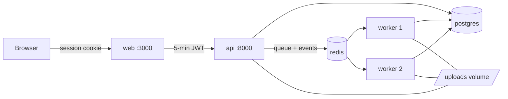

# Running the whole stack with Docker

One command starts everything the hosted app runs:

| Service    | What it is                                          | Reachable at                 |
|------------|-----------------------------------------------------|------------------------------|
| `web`      | Next.js: login, the API proxy, the UI               | http://localhost:3000        |
| `api`      | FastAPI: accepts uploads, queues jobs, streams progress | http://localhost:8000/docs (this computer only) |
| `worker` ×2| `eda-worker`: runs the analyses from the Redis queue | -                            |
| `migrate`  | runs `alembic upgrade head` once, then exits         | -                            |
| `postgres` | Postgres 16: users, runs, reports                    | inside Docker only           |
| `redis`    | Redis 7: job queue, progress events, encrypted key handover | inside Docker only    |



Uploads live in a shared volume that only the API and workers mount, and each file
is deleted as soon as a worker has read it.

## 1. One-time setup

You need Docker Desktop (Windows/macOS) or Docker Engine with Compose v2.

**Secrets for the containers** go in `.env` next to `docker-compose.yml` (git-ignored).
This PowerShell snippet adds any that are missing and leaves existing lines alone. It
reuses `API_JWT_SECRET` from `web/.env.local`, because the web app and the API must share it:

```powershell
function New-Secret {
  $bytes = New-Object byte[] 32
  [Security.Cryptography.RandomNumberGenerator]::Create().GetBytes($bytes)
  -join ($bytes | ForEach-Object { $_.ToString("x2") })
}
if (-not (Test-Path .env)) { New-Item .env -ItemType File | Out-Null }
$current = Get-Content .env -Raw
$webJwt = (Select-String -Path web\.env.local -Pattern '^API_JWT_SECRET=(.+)$').Matches.Groups[1].Value
foreach ($name in "POSTGRES_PASSWORD", "REDIS_PASSWORD", "SECRET_KEY", "API_JWT_SECRET") {
  if ($current -match "(?m)^$name=.+") { Write-Host "$name already set"; continue }
  $value = if ($name -eq "API_JWT_SECRET" -and $webJwt) { $webJwt } else { New-Secret }
  Add-Content .env "$name=$value"
  Write-Host "added $name"
}
```

On macOS/Linux: `for n in POSTGRES_PASSWORD REDIS_PASSWORD SECRET_KEY; do echo "$n=$(openssl rand -hex 32)" >> .env; done`
and copy `API_JWT_SECRET` from `web/.env.local`.

`.env.docker.example` lists every setting Compose reads. `GROQ_API_KEY` (optional) is the
server's own LLM key; without one, users can paste their own Groq key per run, and
without either the report is written from a template (still fully verified).

**The web app's settings** stay in `web/.env.local` (from step 13): `AUTH_SECRET`,
`AUTH_GITHUB_ID`, `AUTH_GITHUB_SECRET`, `API_JWT_SECRET`. Compose overrides `API_URL`
to `http://api:8000`, the API's name inside the Docker network. The GitHub OAuth app's
callback URL stays `http://localhost:3000/api/auth/callback/github`.

## 2. Start, use, stop

```powershell
docker compose up --build -d --wait    # build images, start, wait until healthy (first build ~5 min)
docker compose ps                      # everything "healthy"/"running"; migrate "exited (0)"
start http://localhost:3000
docker compose logs -f api worker      # follow the API and both workers
docker compose down                    # stop (data is kept in volumes)
docker compose down -v                 # stop and delete all data (database, queue, uploads)
```

More workers for a bigger machine: `docker compose up -d --scale worker=4`.

## 3. What the images do

- **`docker/api.Dockerfile`** (used by `api`, `worker` and `migrate`): `python:3.12-slim`,
  dependencies installed from `docker/requirements.lock` (exact versions, generated with
  `uv pip compile`), then the `engine` and `api` packages without re-resolving. Runs as
  an unprivileged user (uid 10001). `MALLOC_ARENA_MAX=2` roughly halves memory use under
  load (see `docs/load-test.md`).
- **`docker/web.Dockerfile`**: three stages on `node:22-bookworm-slim` (install, build,
  run). Only Next.js's standalone server is shipped (~70 MB of app files), running as
  uid 10001. Fonts are bundled, so the image needs no internet access at runtime.
- **`.dockerignore`** keeps `.env` files, data, notebooks, tests and `node_modules` out
  of the build context, so no secret can end up in an image layer.

Regenerate the lock after changing dependencies in `engine/pyproject.toml` or `api/pyproject.toml`:

```powershell
uv pip compile engine/pyproject.toml api/pyproject.toml --python-version 3.12 `
  --python-platform x86_64-unknown-linux-gnu -o docker/requirements.lock -q --no-header
```

## 4. Tests against the running stack

```powershell
# end-to-end (a real browser)
cd e2e; npm ci; npx playwright install chromium
$env:E2E_AUTH_SECRET = (Select-String -Path ..\web\.env.local -Pattern '^AUTH_SECRET=(.+)$').Matches.Groups[1].Value
npm test; cd ..

# load test (see docs/load-test.md)
uv venv .venv-load; uv pip install -p .venv-load -r loadtest/requirements.txt
$env:LOADTEST_JWT_SECRET = (Select-String -Path .env -Pattern '^API_JWT_SECRET=(.+)$').Matches.Groups[1].Value
.venv-load\Scripts\locust -f loadtest/locustfile.py --host http://localhost:8000 --headless -u 40 -r 5 -t 3m
```

CI runs both on every push: it builds the images, starts the stack with throwaway
secrets, runs the Playwright suite and a short load test, and prints the container
logs if anything fails.

## Troubleshooting

| Symptom | Cause / fix |
|---|---|
| `required variable POSTGRES_PASSWORD is missing` | run the setup snippet; `.env` must sit next to `docker-compose.yml` |
| `env file ... web/.env.local not found` | create it as in step 13 (`web/.env.example` lists the keys) |
| Every page says "sign in required" / API 401 | `API_JWT_SECRET` in `.env` differs from `web/.env.local` |
| Port 3000 or 8000 already in use | stop `npm run dev` / `uvicorn` first, or change the left side of `ports:` |
| `migrate` exited with an error | `docker compose logs migrate`; usually a wrong `POSTGRES_PASSWORD` after the volume was created with another one: `docker compose down -v` resets it |
